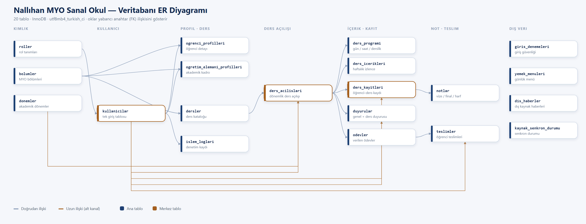

# Nallıhan MYO Sanal Okul

[](https://www.php.net/)
[](https://mariadb.org/)
[](https://www.apachefriends.org/tr/index.html)
[](#gereksinimler)
[](#lisans)

Ankara Üniversitesi Nallıhan Meslek Yüksekokulu Bilgisayar Programcılığı bölümü için
hazırlanmış bir ders projesi. Öğrenci, öğretim elemanı ve yönetici panellerini tek bir
web uygulamasında toplar.

Uygulama; ders kaydı, haftalık ders programı, not ve transkript takibi, ödev teslimi,
duyuru yönetimi, dönem raporları, yemek menüsü ve kampüs haberleri gibi akışları içerir.
Framework kullanılmaz; not ortalaması ve harf notu veritabanı trigger'larıyla, derse kayıt
ise kontrollü bir stored procedure ile hesaplanır.

> **Resmî bir uygulama değildir.** Ders projesi kapsamında geliştirilmiştir; okulun resmî
> bilgi sistemlerinin yerini almaz. İçindeki tüm kullanıcı, ders ve not verileri demo
> amaçlıdır.

**Depo:** <https://github.com/burakyigitsolmaz/sanalokul> · **Geliştirici:** [@burakyigitsolmaz](https://github.com/burakyigitsolmaz)

## Hızlı başlangıç

Windows + XAMPP üzerinde üç adımda çalıştırın:

1. [XAMPP](https://www.apachefriends.org/tr/index.html) kurun; **Apache** ve **MySQL**'i başlatın.
2. Projeyi indirip `C:\xampp\htdocs\sanalokul` klasörüne çıkarın.
3. Klasördeki **`kur.bat`** dosyasına çift tıklayın.

Ardından tarayıcıda açın:

```text
http://localhost/sanalokul/
```

`kur.bat`; veritabanını oluşturur, tablo/görünüm/trigger/prosedürleri yükler, demo verileri
ekler ve `config/config.local.php` dosyasını hazırlar. İşlem yaklaşık 1 dakika sürer.

> `.bat` dosyası çalıştırmak istemiyorsanız [Kurulum (elle)](#kurulum-elle) bölümüne geçin.

## Özellikler

### Öğrenci

- Ders kaydı, haftalık ders programı (yazdırma ve `.ics` takvim indirme)
- Notlar, transkript ve dönem ortalaması
- Ödev teslimi ve geri bildirim takibi
- Duyurular, yemek menüsü, kampüs haberleri
- Açık/koyu tema

### Öğretim elemanı

- Ders listesi ve öğrenci takibi
- Vize/final not girişi (ortalama ve harf notu otomatik hesaplanır)
- Ödev değerlendirme ve dosya indirme
- Ders duyuruları ve haftalık program

### Yönetici

- Kullanıcı, bölüm, dönem, ders, ders açılışı ve ders atama yönetimi
- Dönem raporları, başarı istatistikleri ve CSV aktarımı
- Veritabanı ve ER diyagramı görüntüleme
- İşlem logları, veri senkronizasyonu ve yedekleme

## Gereksinimler

| Bileşen | Sürüm / Not |
|---|---|
| İşletim sistemi | Windows 10/11 (XAMPP ile) |
| XAMPP | PHP 8.2+ ve MariaDB 10.4+ |
| PHP eklentileri | `pdo_mysql`, `mbstring`, `fileinfo`, `zip`, `openssl`, `curl` |
| Tarayıcı | Chrome, Edge, Firefox veya Safari |

Uygulama başka bir Apache + PHP + MySQL ortamında da çalışır; bu durumda SQL dosyalarını
[Kurulum (elle)](#kurulum-elle) bölümündeki sırayla içe aktarın.

## Kurulum

### 1. XAMPP

XAMPP Control Panel'den **Apache** ve **MySQL**'i başlatın. İki servisin de yeşil olması
gerekir.

### 2. Projeyi indir

**Git ile** (önerilir):

```bat
git clone https://github.com/burakyigitsolmaz/sanalokul.git C:\xampp\htdocs\sanalokul
```

**Git olmadan:** depo sayfasında **Code → Download ZIP** ile indirin, arşivi çıkarın ve
klasörü şu konuma taşıyın:

```text
C:\xampp\htdocs\sanalokul
```

> Klasör adı **`sanalokul`** olmalıdır. GitHub ZIP'i `sanalokul-main` olarak açılır; adını
> `sanalokul` yapın. Adresler bu klasör adına göre tanımlıdır.

### 3. Veritabanını kur

Proje klasöründeki **`kur.bat`** dosyasına çift tıklayın. Betik sırayla:

- klasör adının `sanalokul` olduğunu doğrular,
- `config/config.local.php` dosyasını örnekten oluşturur,
- MySQL bağlantısını kontrol eder (root şifresi varsa bir kez sorar),
- `database/` altındaki altı SQL dosyasını sırayla çalıştırır,
- kurulum özetini yazar.

### 4. Çalıştır

```text
http://localhost/sanalokul/
```

### 5. Kurulumu doğrula

Sağlık kontrolü sayfası veritabanı nesnelerini ve PHP eklentilerini listeler:

```text
http://localhost/sanalokul/kurulum.php
```

Beklenen değerler: **20 tablo, 8 görünüm, 4 trigger, 4 prosedür**.

## Kurulum (elle)

`kur.bat` çalıştırmak istemeyenler için iki alternatif vardır. İkisinde de önce ayar
dosyasını oluşturun:

```bat
cd C:\xampp\htdocs\sanalokul
copy config\config.local.ornek.php config\config.local.php
```

### A) Komut satırı ile

`cmd` açıp SQL dosyalarını sırayla içe aktarın:

```bat
cd C:\xampp\htdocs\sanalokul

C:\xampp\mysql\bin\mysql.exe -u root < database\00_kurulum.sql
C:\xampp\mysql\bin\mysql.exe -u root sanalokul < database\01_schema.sql
C:\xampp\mysql\bin\mysql.exe -u root sanalokul < database\02_views.sql
C:\xampp\mysql\bin\mysql.exe -u root sanalokul < database\03_triggers.sql
C:\xampp\mysql\bin\mysql.exe -u root sanalokul < database\04_procedures.sql
C:\xampp\mysql\bin\mysql.exe -u root sanalokul < database\05_seed.sql
```

MySQL root şifresi varsa `-u root` yerine `-u root -p` yazın.

### B) phpMyAdmin ile

1. Tarayıcıda <http://localhost/phpmyadmin> adresini açın.
2. **İçe aktar** sekmesinden `database\00_kurulum.sql` dosyasını yükleyin.
3. Sol listede **`sanalokul`** veritabanını seçin.
4. Sırayla `01_schema.sql`, `02_views.sql`, `03_triggers.sql`, `04_procedures.sql`,
   `05_seed.sql` dosyalarını içe aktarın.

> Sıra önemlidir: `00 → 01 → 02 → 03 → 04 → 05`. Sıra bozulursa yabancı anahtarlar ve
> görünümler hata verir.

Ayar dosyasındaki bağlantı bilgileri (`config/config.local.php`):

```php
<?php
return [
    'host' => '127.0.0.1',
    'port' => 3306,
    'name' => 'sanalokul',
    'user' => 'sanalokul_app',
    'pass' => 'SanalOkul_2026!App',
];
```

Bu dosya `.gitignore` içindedir; depoda bulunmaz. `00_kurulum.sql` içindeki şifreyi
değiştirirseniz buradaki `pass` değerini de aynı yapın.

## Aynı ağdaki cihazlardan erişim

Telefon veya tabletten açmak için cihazı bilgisayarla aynı Wi-Fi ağına bağlayın.
Bilgisayarda `cmd` açıp `ipconfig` yazın; **IPv4** satırındaki adresi not alın.
Telefonun tarayıcısına şunu yazın (`IPv4` yerine o adresi koyun):

```text
http://IPv4/sanalokul/
```

`localhost` yalnızca o bilgisayarda çalışır. Adres açılmıyorsa Windows güvenlik
duvarından Apache'ye izin verin. Ağ cihazları birbirini görmüyorsa bilgisayarda
mobil etkin nokta açıp `ipconfig` ile görünen IPv4 adresini kullanın.

## Demo hesaplar

Tüm demo hesapların şifresi: **`Sanal1234!`**

| Rol | Ad Soyad | E-posta |
|---|---|---|
| Yönetici | Sistem Yönetici | `yonetici@ornek.local` |
| Öğrenci | Burak Yiğit Solmaz | `burak.solmaz@ornek.local` |
| Öğrenci | Kaan Tokatlı | `kaan.tokatli@ornek.local` |
| Öğretim elemanı | Ayhan Aydın | `ayhan.aydin@ornek.local` |
| Öğretim elemanı | Ufuk Tanyeri | `ufuk.tanyeri@ornek.local` |
| Öğretim elemanı | Salih Erdurucan | `salih.erdurucan@ornek.local` |
| Öğretim elemanı | Güney Uğurlu | `guney.ugurlu@ornek.local` |

Giriş ekranındaki demo kartından bir hesaba tıklandığında e-posta ve şifre otomatik dolar.

## Teknolojiler

| Katman | Teknoloji |
|---|---|
| Sunucu | Apache (XAMPP) |
| Backend | PHP 8.2+ · PDO prepared statement |
| Veritabanı | MariaDB 10.11 · InnoDB · `utf8mb4_turkish_ci` |
| Frontend | HTML5, CSS3, vanilla JavaScript |
| Dış veri | XLSX (yemek menüsü), WordPress REST API (kampüs haberleri) |
| Sürüm kontrolü | Git / GitHub |

## Proje yapısı

```text
sanalokul/
├── admin/          Yönetici paneli
├── assets/         CSS, JavaScript ve görseller
├── config/         Uygulama ve veritabanı ayarları
├── cron/           Zamanlanmış görevler
├── database/       Şema, görünüm, trigger, prosedür ve demo veri
├── docs/           ER diyagramı
├── ogrenci/        Öğrenci paneli
├── ogretmen/       Öğretim elemanı paneli
├── scripts/        Yedekleme betiği
├── src/            Sınıflar ve yardımcılar
├── templates/      Ortak sayfa şablonları
├── uploads/        Ödev dosyaları
├── giris.php       Giriş ekranı
├── kurulum.php     Kurulum sağlık kontrolü
├── kur.bat         Windows kurulum betiği
└── index.php       Ana sayfa
```

## Veritabanı

| Dosya | İçerik |
|---|---|
| `00_kurulum.sql` | Veritabanı, uygulama kullanıcısı ve yetkiler |
| `01_schema.sql` | 20 tablo, kısıtlar, yabancı anahtarlar ve indeksler |
| `02_views.sql` | 8 görünüm (not özeti, başarı, doluluk, dönem vb.) |
| `03_triggers.sql` | 4 trigger (not hesabı, kontenjan, log) |
| `04_procedures.sql` | 4 prosedür (derse kayıt, dönem ortalaması, raporlar) |
| `05_seed.sql` | Demo veri: bölüm, dönem, ders, kullanıcı, not, ödev, duyuru |

Sıra önemlidir: `00 → 01 → 02 → 03 → 04 → 05`.



Diyagram, yönetici panelindeki **Veritabanı** sayfasında da görüntülenebilir.

## Güvenlik

- Tüm sorgular PDO prepared statement ile yazılmıştır.
- Şifreler `password_hash` / `password_verify` ile saklanır.
- Formlarda CSRF token doğrulaması yapılır.
- CSP, `X-Frame-Options`, `X-Content-Type-Options` ve HSTS başlıkları gönderilir.
- Hatalı girişlerde hesap ve IP bazlı deneme limiti uygulanır.
- Dosya yüklemede boyut, uzantı ve MIME türü kontrol edilir.

## Sorun giderme

| Belirti | Çözüm |
|---|---|
| `Proje klasörünün adı "sanalokul" olmalı` | Klasörü `C:\xampp\htdocs\sanalokul` olarak yeniden adlandırın |
| `mysql.exe bulunamadı` | XAMPP'ın `C:\xampp` altında kurulu olduğunu kontrol edin |
| `MySQL'e bağlanılamadı` | XAMPP'tan MySQL'i başlatın; root şifresini doğru girin |
| `Access denied for user 'sanalokul_app'` | `kur.bat` tekrar çalıştırın veya `config.local.php` şifresini kontrol edin |
| `Unknown database 'sanalokul'` | `00_kurulum.sql` çalışmamış; kurulumu baştan yapın |
| `Table ... doesn't exist` | SQL dosyaları sıra dışı çalıştırılmış; `00 → 05` sırasını koruyun |
| Apache başlamıyor | 80. portu kullanan uygulamayı kapatın (Skype, IIS) veya portu değiştirin |
| Sayfa tamamen boş | `config/config.local.php` var mı kontrol edin; Apache `error.log` dosyasına bakın |
| Türkçe karakterler bozuk | Veritabanı `utf8mb4_turkish_ci` olmalı; `01_schema.sql` ile yeniden kurun |

## Lisans

Bu proje eğitim amacıyla geliştirilmiştir ve resmî bir uygulama değildir; okulun resmî
bilgi sistemlerinin yerini almaz. İçindeki tüm e-posta, telefon, şifre ve akademik veriler
demo amaçlıdır, gerçek kişisel veri içermez. Yayına almadan önce demo hesaplar ve
veritabanı şifresi değiştirilmelidir.
