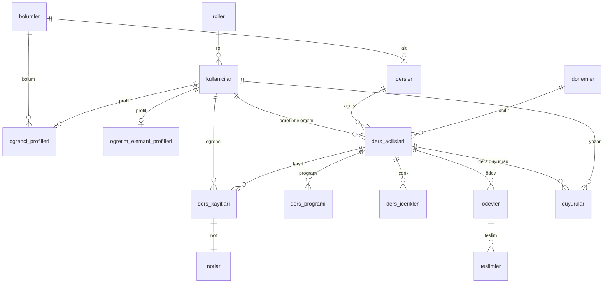

# Nallıhan MYO Sanal Okul — Teslim Dokümanı

**Ders projesi** · Ankara Üniversitesi Nallıhan Meslek Yüksekokulu
Bilgisayar Programcılığı · 2025–2026

> Bu uygulama resmî bir uygulama değildir. Ders projesi kapsamında geliştirilmiştir;
> okulun resmî bilgi sistemlerinin yerini almaz. İçindeki e-posta, telefon ve
> şifreler demo amaçlıdır.

---

## 1. Proje künyesi

| Alan | Bilgi |
|---|---|
| Proje adı | Nallıhan MYO Sanal Okul |
| Sürüm | v0.1.0 |
| Tür | PHP + MySQL (MariaDB) web uygulaması |
| Arayüz | Türkçe, mobile-first, koyu tema varsayılan (açık/sistem seçenekli) |
| Sunucu | Apache + PHP 8 (XAMPP) |
| Veritabanı | MariaDB 10.11 · `utf8mb4_turkish_ci` |
| Adres | `http://localhost/sanalokul/` |
| Kod | `C:\xampp\htdocs\sanalokul\` |

### Kullanılan teknolojiler

- **Backend:** PHP 8, PDO (prepared statements, `ATTR_EMULATE_PREPARES = false`)
- **Veritabanı:** MariaDB — 20 tablo, 8 view, 4 trigger, 4 stored procedure
- **Frontend:** HTML5, CSS3 (özel tasarım sistemi, CSS değişkenleri), vanilla JS
- **Dış veri:** SKS aylık yemek menüsü (XLSX) ve Nallıhan MYO WordPress REST API

---

## 2. Kurulum

### 2.1. Gereksinimler

- XAMPP (Apache + PHP 8.2+ + MariaDB 10.4+)
- PHP eklentileri: `pdo_mysql`, `mbstring`, `fileinfo`, `zip`, `openssl`

### 2.2. Dosyaları yerleştir

Projeyi `C:\xampp\htdocs\sanalokul\` altına kopyalayın.

### 2.3. Veritabanını kur

Sırayla, `mysql.exe` ile (root kullanıcısı):

```bat
cd C:\xampp\htdocs\sanalokul

C:\xampp\mysql\bin\mysql.exe -u root < database\00_kurulum.sql
C:\xampp\mysql\bin\mysql.exe -u root sanalokul < database\01_schema.sql
C:\xampp\mysql\bin\mysql.exe -u root sanalokul < database\02_views.sql
C:\xampp\mysql\bin\mysql.exe -u root sanalokul < database\03_triggers.sql
C:\xampp\mysql\bin\mysql.exe -u root sanalokul < database\04_procedures.sql
C:\xampp\mysql\bin\mysql.exe -u root sanalokul < database\05_seed.sql
C:\xampp\mysql\bin\mysql.exe -u root sanalokul < database\06_seed_faz3.sql
C:\xampp\mysql\bin\mysql.exe -u root sanalokul < database\07_rapor.sql
C:\xampp\mysql\bin\mysql.exe -u root sanalokul < database\08_performans.sql
```

| Dosya | İçerik |
|---|---|
| `00_kurulum.sql` | Veritabanı + `sanalokul_app` kullanıcısı + izinler |
| `01_schema.sql` | 20 tablo, kısıtlar, indeksler |
| `02_views.sql` | Öğrenci not özeti, başarı istatistiği, günün programı |
| `03_triggers.sql` | Ortalama/harf notu hesabı, kontenjan ve log tetikleyicileri |
| `04_procedures.sql` | Derse kayıt, dönem ortalaması |
| `05_seed.sql` | Bölüm, dönem, ders, kullanıcı, not çekirdek verisi |
| `06_seed_faz3.sql` | Program, ödev, teslim, duyuru örnekleri |
| `07_rapor.sql` | Rapor view'leri + `sp_donem_raporu`, `sp_riskli_ogrenciler` |
| `08_performans.sql` | Rapor ve panel sorguları için bileşik indeksler |

### 2.4. Uygulama ayarı

`config/config.local.php` dosyası (git'e girmez):

```php
<?php
return [
    'host' => '127.0.0.1',
    'port' => 3306,
    'name' => 'sanalokul',
    'user' => 'sanalokul_app',
    'pass' => 'SanalOkul_2026!App',
];
```

> Gerçek sunumda `00_kurulum.sql` içindeki şifreyi değiştirip buraya aynı şifreyi yazın.

### 2.5. Çalıştır

Apache ve MySQL'i XAMPP panelinden başlatın, tarayıcıda açın:

```
http://localhost/sanalokul/
```

---

## 3. Demo hesaplar

| Rol | E-posta | Şifre |
|---|---|---|
| Yönetici | `yonetici@ornek.local` | `Sanal1234!` |
| Öğrenci (1. sınıf) | `burak.solmaz@ornek.local` | `Sanal1234!` |
| Öğrenci (2. sınıf) | `deniz.yildiz@ornek.local` | `Sanal1234!` |
| Öğretim elemanı | `ayhan.aydin@ornek.local` | `Sanal1234!` |
| Öğretim elemanı | `ufuk.tanyeri@ornek.local` | `Sanal1234!` |

Tüm demo hesaplar `@ornek.local` adresini kullanır.

---

## 4. Özellikler

### 4.1. Öğrenci paneli

- Derslerim: aktif kayıtlar, kredi/AKTS, harf notu
- Ders programı: haftalık görünüm
- Notlarım: vize/final, ortalama, harf notu (trigger ile hesaplanır)
- Transkript: dönem bazlı döküm + yazdırma
- Ödevler: dosya teslimi (PDF/DOC/DOCX/ZIP/PNG/JPG, en fazla 10 MB)
- Duyurular: genel ve ders duyuruları

### 4.2. Öğretim elemanı paneli

- Ders listesi ve ders yönetimi
- Not girişi (vize %40, final %60; ortalama ve harf notu otomatik)
- Ödev oluşturma, teslimleri değerlendirme, dosya indirme
- Ders içeriği ve haftalık plan yönetimi
- Ders ve genel duyuru yayınlama

### 4.3. Yönetici paneli

- Kullanıcı CRUD + CSV ile toplu öğrenci aktarma
- Bölüm, dönem, ders ve ders açılışı CRUD
- Derse öğrenci atama (`sp_derse_kayit_ol`: kontenjan, çakışma, mükerrer kontrol)
- Genel duyuru yönetimi
- İşlem logları (arama + sayfalama)
- Veri senkronizasyonu: yemek menüsü (XLSX) + kampüs haberleri (REST API)
- **Raporlar:** dönem özeti, ders doluluğu/başarısı, harf notu dağılımı,
  bölüm özeti, öğretim elemanı yükü, akademik risk listesi, CSV indirme, yazdırma

### 4.4. Genel

- Ana sayfada günün/yaklaşan yemek menüsü ve son kampüs haberleri
- Koyu / açık / sistem teması (kullanıcı tercihi veritabanında saklanır)
- Mobil uyumlu düzen (390 px'te yatay taşma yok)
- Alt bilgide "resmî uygulama değildir" notu

---

## 5. Veritabanı tasarımı

### 5.1. Tablolar

| Grup | Tablolar |
|---|---|
| Kullanıcı | `roller`, `kullanicilar`, `ogrenci_profilleri`, `ogretim_elemani_profilleri` |
| Akademik | `bolumler`, `donemler`, `dersler`, `ders_acilislari`, `ders_kayitlari`, `notlar` |
| İçerik | `ders_programi`, `ders_icerikleri`, `odevler`, `teslimler`, `duyurular` |
| Sistem | `islem_loglari`, `giris_denemeleri` |
| Dış veri | `yemek_menuleri`, `dis_haberler`, `kaynak_senkron_durumu` |

### 5.2. Görünümler (VIEW)

`v_ogrenci_not_ozeti`, `v_ders_basari_istatistik`, `v_bugunun_programi`,
`v_ders_doluluk`, `v_ogretim_elemani_yuku`, `v_donem_ozet`,
`v_harf_notu_dagilimi`, `v_bolum_ozet`

### 5.3. Tetikleyiciler (TRIGGER)

| Trigger | Görev |
|---|---|
| `trg_not_hesapla` | Vize/final girilince ortalamayı hesaplar |
| `trg_harf_notu` | Ortalamaya göre harf notunu yazar |
| `trg_kayit_kontenjan` | Kontenjan aşımını engeller |
| `trg_kayit_log` | Kayıt değişikliklerini loglar |

### 5.4. Prosedürler (PROCEDURE)

| Prosedür | Görev |
|---|---|
| `sp_derse_kayit_ol` | Kontenjan + program çakışması + mükerrer kontrol, transaction |
| `sp_donem_ortalamasi` | Öğrencinin dönem ortalaması |
| `sp_donem_raporu` | Ders bazlı dönem raporu (result set) |
| `sp_riskli_ogrenciler` | Ortalaması eşik altı veya başarısız dersi olanlar |

### 5.5. İlişki özeti



---

## 6. Güvenlik önlemleri

| Konu | Uygulama |
|---|---|
| SQL enjeksiyonu | Tüm sorgular PDO prepared statement; `EMULATE_PREPARES = false` |
| XSS | Çıktılarda `e()` / `htmlspecialchars`; CSP ile satır içi betik sınırı |
| CSRF | Her POST formunda token + `hash_equals` doğrulaması |
| Şifreler | `password_hash` (bcrypt); düz metin şifre yok |
| Brute force | Hesap başına 5, IP başına 25 hatalı deneme → 15 dk kilit |
| Oturum | `HttpOnly`, `SameSite=Lax`, HTTPS'te `Secure`, strict mode, 2 saat hareketsizlik, 30 dk'da kimlik yenileme |
| Yetkilendirme | Rol bazlı `Auth::rolGerekli`; öğretmen yalnızca kendi dersine erişir |
| Dosya yükleme | Uzantı + MIME (`finfo`) + boyut kontrolü, rastgele ad, `uploads/` web erişimine kapalı |
| Güvenlik başlıkları | CSP (nonce), `X-Frame-Options: DENY`, `nosniff`, Referrer-Policy, Permissions-Policy, COOP/CORP; HTTPS'te HSTS |
| Loglama | Giriş/çıkış, CRUD, CSV, senkron ve rapor indirmeleri `islem_loglari`'nda |

> Not: Uygulama HTTP üzerinde geliştirme içindir. Yayına alınacaksa HTTPS zorunlu
> tutulmalı, `config.local.php` şifresi değiştirilmeli ve demo hesaplar kaldırılmalıdır.

---

## 7. Performans

`database/08_performans.sql` ile eklenen bileşik indeksler:

| İndeks | Tablo | Kullanım |
|---|---|---|
| `idx_dk_ders_durum` | `ders_kayitlari (ders_acilis_id, durum)` | Rapor view'lerindeki aktif kayıt filtresi |
| `idx_da_hoca_donem` | `ders_acilislari (ogretim_elemani_id, donem_id)` | Hoca yükü raporu |
| `idx_kullanici_rol_aktif` | `kullanicilar (rol_id, aktif)` | Panel rol sayaçları |
| `idx_log_tablo_zaman` | `islem_loglari (tablo_adi, zaman)` | Log filtresi + sıralama |
| `idx_duyuru_hedef_tarih` | `duyurular (ders_acilis_id, yayin_tarihi)` | Duyuru listeleri |
| `idx_teslim_ogrenci_zaman` | `teslimler (ogrenci_id, teslim_zamani)` | Teslim geçmişi |

Tüm raporlar anlık veriden üretilir; ayrı özet tablo yoktur. Veri hacmi büyürse
dönem bazlı özet tablolar veya materyalize view düşünülebilir.

---

## 8. Yedekleme

### 8.1. Elle yedek

```bat
C:\xampp\php\php.exe scripts\yedekle.php
```

- Çıktı: `yedekler\sanalokul-YYYYmmdd-HHMMSS.sql.gz`
- Varsayılan olarak son **10** yedek tutulur; eski dosyalar otomatik silinir.
- `--sakla=20` ile saklanacak yedek sayısı değiştirilebilir.
- Yedek klasörü web'den erişime kapalıdır (`yedekler/.htaccess`).

### 8.2. Haftalık otomatik yedek (Windows)

Görev Zamanlayıcısı → Yeni Görev → Haftalık:

```
Program: C:\xampp\php\php.exe
Bağımsız değişken: scripts\yedekle.php
Başlangıç dizini: C:\xampp\htdocs\sanalokul
```

### 8.3. Geri yükleme

```bat
"C:\Program Files\7-Zip\7z.exe" e yedekler\sanalokul-YYYYmmdd-HHMMSS.sql.gz -so | C:\xampp\mysql\bin\mysql.exe -u root sanalokul
```

veya `.sql.gz` dosyasını açıp:

```bat
C:\xampp\mysql\bin\mysql.exe -u root sanalokul < yedek.sql
```

---

## 9. Test kontrol listesi

| Test | Beklenen |
|---|---|
| 60 PHP dosyası `php -l` | Sözdizimi temiz |
| Giriş (3 rol) | Doğru panele yönlendirme |
| Hatalı şifre × 5 | Hesap 15 dk kilitli |
| Rol dışı erişim | 403 |
| CSRF'siz POST | Reddedilir |
| Not girişi | Ortalama/harf notu trigger ile güncellenir |
| Derse kayıt | Kontenjan/çakışma kontrolü çalışır |
| Rapor ekranı | Dönem 3: 11 ders, %80 başarı, 9 riskli öğrenci |
| CSV indirme | UTF-8 BOM, `;` ayırıcı, Türkçe karakterler doğru |
| Yedek betiği | `.sql.gz` oluşur, tablo/view/trigger/prosedür sayıları doğru |
| Mobil 390 px | Yatay taşma yok |
| Güvenlik başlıkları | CSP + X-Frame-Options + nosniff + HSTS (HTTPS'te) |

---

## 10. Klasör yapısı

```
sanalokul/
├── admin/            Yönetici paneli sayfaları
├── ogrenci/          Öğrenci paneli sayfaları
├── ogretmen/         Öğretim elemanı paneli sayfaları
├── assets/           CSS, JS, görseller
├── config/           config.php + config.local.php (gizli)
├── database/         00–08 SQL dosyaları
├── docs/             ILERLEME.md, TESLIM.md, ekran görüntüleri
├── scripts/          yedekle.php (CLI)
├── src/              Auth, Database, Guvenlik, Ogrenci, Ogretmen, Yonetici, Rapor, Senkron
├── templates/        Ortak üst/alt şablonlar
├── uploads/          Ödev teslimleri (web erişimine kapalı)
├── yedekler/         Veritabanı yedekleri (web erişimine kapalı)
└── index.php         Ana sayfa
```

---

## 11. Ekran görüntüleri

| Ana sayfa | Öğrenci paneli |
|---|---|
|  |  |

| Öğretim elemanı not girişi | Yönetici raporları |
|---|---|
|  |  |

---

## 12. Bilinen sınırlar

- Yoklama modülü kapsam dışıdır.
- Duyuru düzenleme, sil + yeniden ekle mantığıyla çalışır.
- Dış kaynaklar (SKS menü, kampüs haberleri) internet erişimine bağlıdır;
  erişilemezse senkron "hata" durumuna düşer, uygulama çalışmaya devam eder.
- Mesajlaşma/bildirim modülü yoktur.
- Yedek betiği yerel makine içindir; uzak sunucuya kopyalama yapmaz.
